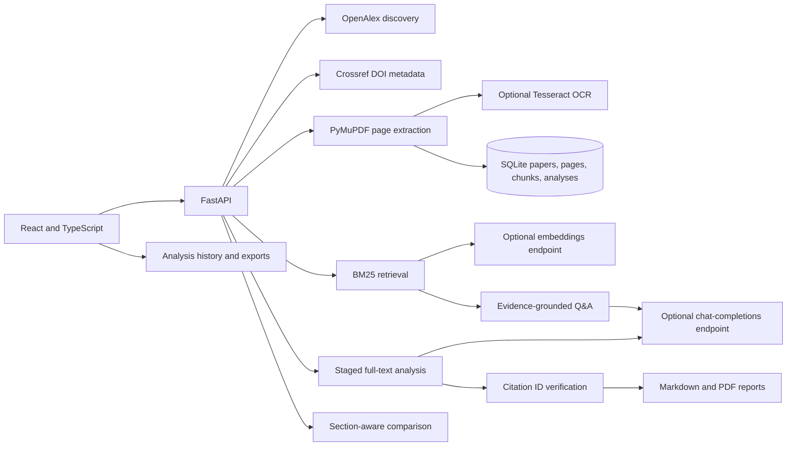

# Architecture

## Request and data flow

## Components

- backend/app/api/papers.py exposes OpenAlex search and Crossref DOI verification with input validation and upstream error mapping.
- backend/app/services/openalex_service.py parses works, reconstructs OpenAlex inverted-index abstracts, normalizes DOI values, and merges duplicate results.
- backend/app/services/crossref_service.py validates DOI syntax, retrieves the matching Crossref work, checks the returned DOI, and maps Crossref errors.
- backend/app/api/library.py validates PDF uploads and exposes library, page, delete, metadata, and comparison routes.
- backend/app/services/pdf_service.py extracts each PDF page independently, attempts detectable table extraction, chunks text within pages, and runs OCR only when enabled and Tesseract is available.
- backend/app/services/document_structure.py detects explicit section headings and keeps page provenance while splitting and aggregating passages.
- backend/app/services/library_repository.py uses additive SQLite schema initialization for paper metadata, document metadata, page text, section-aware chunks, and analysis history. Existing papers and PDFs are retained.
- backend/app/services/retrieval_service.py implements BM25 keyword retrieval and optional semantic ranking with reciprocal-rank fusion. Embeddings are not persisted.
- backend/app/services/assistant_service.py retrieves fresh evidence for every question, uses recent conversation only as context, verifies answer markers against the current evidence set, and falls back to quoted passages or abstention.
- backend/app/services/analysis_service.py builds an evidence unit for each stored chunk, labels text coverage, summarizes explicit sections, processes long papers in bounded batches when an external model is opted into, and validates all referenced evidence IDs.
- backend/app/services/analysis_repository.py stores queued/running/completed/failed analysis jobs. Interrupted jobs are marked failed when the API restarts.
- backend/app/services/report_export.py renders evidence-referenced Markdown and PDF reports.
- backend/app/services/comparison_service.py extracts explicit objectives, methods, datasets, experimental design, baselines, metrics, findings, strengths, limitations, research gaps, and future-work headings. Missing headings are not guessed.
- frontend/src/App.tsx presents discovery, library, analysis, Q&A, comparison, and history flows. frontend/src/styles.css provides the responsive LitLens interface.

## Storage model

- papers stores scholarly metadata, source type, PDF path, extraction status, page count, and document metadata.
- pages stores extracted text keyed by paper ID and page number.
- chunks stores page-local evidence and a detected section label.
- paper_analyses stores analysis status, progress, report JSON, errors, and timestamps.
- PDFs are stored under data/uploads. SQLite is the configured local store.

Schema initialization uses CREATE TABLE IF NOT EXISTS and additive ALTER TABLE migrations. Tests use temporary data folders. The application does not reset the user's library.

## Evidence and privacy boundaries

- PDF citations identify a paper, section, chunk, and page. Abstract citations have no PDF page and are explicitly labeled.
- Citation validation checks evidence IDs against the current retrieved or analyzed source set; it does not prove claim entailment.
- Provider-assisted paper analysis sends extracted PDF text to the configured provider only after explicit opt-in in the interface. Local extractive analysis is available without an LLM credential.
- Author-reported limitations, potential concerns, confirmed inconsistencies, and information gaps are distinct categories. Missing details are not by themselves proof of an error.
- Figures are not visually interpreted. Table extraction and heading detection can miss unusual layouts. OCR depends on a separate Tesseract installation; it was unavailable in the checked environment.
- Potential research directions are limited to the selected papers and do not establish global novelty.
